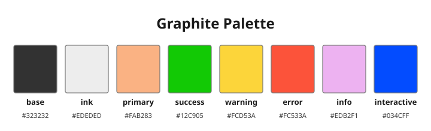

<p align="center">
  
</p>

<h1 align="center">OpenCode Desktop re:themes</h1>

<p align="center">Build and verify a custom OpenCode Desktop theme by patching its renderer bundle.</p>

<p align="center">
  
  
  
  
  <a href="https://github.com/L1m4y/OpenCode-Desktop-re-themes/actions/workflows/ci.yml">
    
  </a>
</p>

## Why this exists

OpenCode's TUI has a documented [JSON theme system](https://opencode.ai/docs/themes/). OpenCode Desktop does not expose a user theme loader: its themes are bundled into the renderer as Vite chunks. This project builds a patched `app.asar` that registers an extra theme, without touching the rest of the application.

`Graphite` is only the default preset. The id, display name, surface color and text color are build options, so the same tool can produce other flat dark themes. The palette below belongs to the default preset.

<p align="center">
  
</p>

## Quick start

```bash
git clone https://github.com/L1m4y/OpenCode-Desktop-re-themes.git
cd OpenCode-Desktop-re-themes
```

Check the installed archive first. If it reports `modified`, reinstall the official package before building.

```bash
python -m oc_theme info
```

Back up the current archive, then build a patched one. The build validates the
output and prints a verification table:

```bash
python -m oc_theme backup
python -m oc_theme build
```

`backup` prints the path it wrote. Keep it; the restore command needs it.

Install the archive after the build reports `done`:

```bash
sudo cp build/app-graphite.asar /usr/lib/opencode-desktop/app.asar
```

Close OpenCode Desktop from the tray before copying, then open it and select **Graphite** in appearance settings.

To restore the original archive:

```bash
sudo python -m oc_theme restore --backup backups/app.asar.<timestamp> --yes
```

## Requirements

- Linux (the patch targets `/usr/lib/opencode-desktop/app.asar`)
- Python 3.10 or newer
- Node.js 20 or newer for `node --check`
- A clean installation of OpenCode Desktop

## CLI

| Command | Purpose |
| --- | --- |
| `python -m oc_theme info` | Show the package version, header padding, main chunk, source status and theme ids. |
| `python -m oc_theme backup` | Copy the installed archive to `backups/app.asar.<timestamp>`. |
| `python -m oc_theme build` | Build `build/app-graphite.asar` and verify it. |
| `python -m oc_theme verify --asar <file>` | Validate framing, offsets, patch anchors and generated JavaScript. |
| `python -m oc_theme extract --asar <file> --path <path>` | Extract one file from an archive. |
| `python -m oc_theme restore --backup <file> --yes` | Copy a backup over the installed archive. |
| `python -m oc_theme tokens` | Print the flattened classic and v2 token lists. |

Useful build options:

```text
--theme-id graphite          theme id written to the map and registry
--theme-name Graphite        display name
--base-color "#323232"       target surface color
--text-color "#EDEDED"       dark-mode text color
--render-shift 3             compensation for the renderer's +3 per channel
--force                      allow a source archive that is already modified
--dry-run                    generate and validate without writing the archive
```

To build a different theme, change the id, name and colors:

```bash
python -m oc_theme build --theme-id midnight --theme-name "Midnight" \
  --base-color "#1a1a1a" --text-color "#e6e6e6"
```

The output becomes `build/app-midnight.asar`.

## What the build does

1. Reads the ASAR Pickle header and detects the real padding (`b - len(json) - 8`).
2. Extracts the renderer `main-*.js` chunk and the light/dark theme objects.
3. Adds one lazy import entry, one quoted registry entry and one `:root` stylesheet.
4. Rebuilds the archive with contiguous offsets, updated integrity hashes and the new theme chunk.
5. Runs `node --check` on the patched main and the theme module.
6. Verifies the output against the original archive: framing, coverage, untouched files and exported theme bindings.

The archive rebuild is deliberately conservative: every untouched file is copied byte-for-byte, and only the main chunk, its integrity hash and the new theme chunk change.

The builder matches structure, not hashed filenames. If a release changes the theme map, registry or stylesheet assignment, `build` fails with a clear message instead of writing an invalid archive.

## Limitations

- Linux only. macOS and Windows builds are code-signed and use ASAR integrity validation; this project does not update the external header hash.
- A package update overwrites `app.asar`. Rebuild from the official package after every update.
- The theme is a single flat dark surface. It only applies in dark mode; in light mode it falls back to the default light theme. It is not a theme marketplace or a live theme switcher.
- The `+3` render compensation is an observed behavior, not a documented API. If the renderer changes, adjust `--render-shift`.
- Modifying a local installation is your responsibility. Back up the archive and keep the restore command handy.

## Project layout

```text
oc_theme/            ASAR reader/writer, theme generator, patch and verification code
tests/               unit and integration tests with a synthetic archive
docs/                architecture, build workflow and troubleshooting
assets/              palette preview
icons/               project logo
.github/workflows/   CI (ruff and unittest)
```

## Documentation

- [`docs/ARCHITECTURE.md`](docs/ARCHITECTURE.md) — ASAR envelope, theme pipeline and patch points.
- [`docs/BUILD.md`](docs/BUILD.md) — build, verify, install, restore and port to a new release.
- [`docs/TROUBLESHOOTING.md`](docs/TROUBLESHOOTING.md) — known failures and the version log.

## Contributing

See [`CONTRIBUTING.md`](CONTRIBUTING.md). Run the test suite and `ruff check .` before opening a pull request.

## License and disclaimer

GNU General Public License v3.0 or later. See [`LICENSE`](LICENSE) and [`NOTICE`](NOTICE).

This project is not affiliated with OpenCode or Anomaly. It does not redistribute OpenCode Desktop; it generates a patched archive from a local installation.
